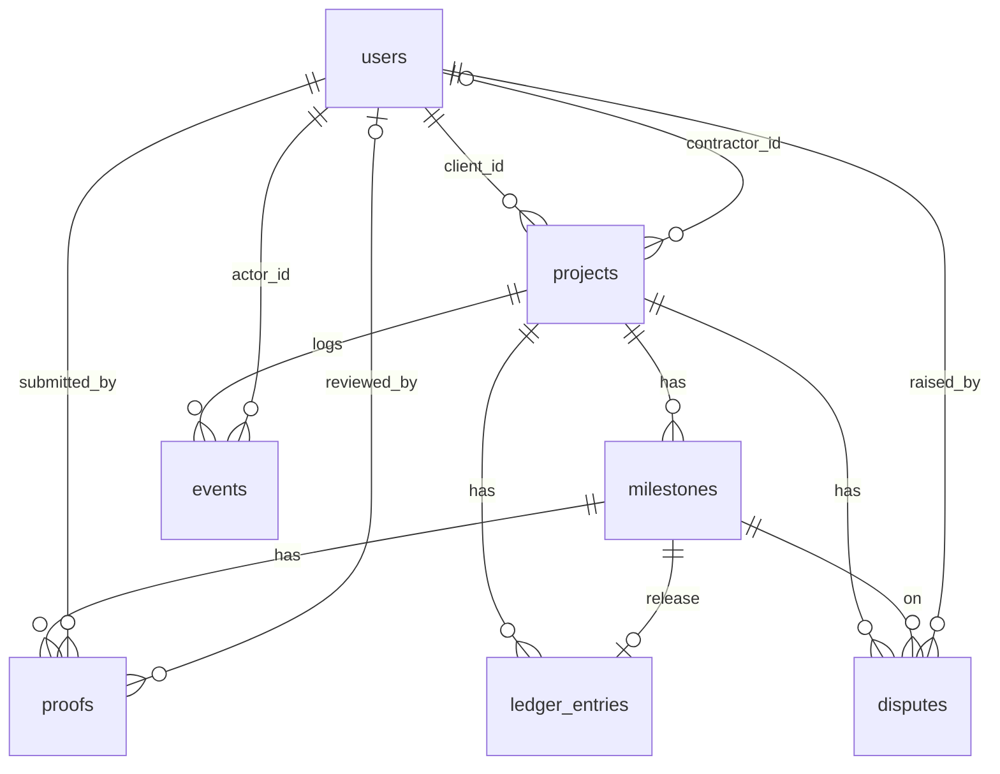

# DBMS 01 — Normalization of BuildBond

**Course:** Advanced Programming and Data Engineering · Newton School of Technology
**App:** [BuildBond](https://github.com/sakshamkachhawaha/BuildBond) — milestone-based proof-of-work and payment tracking
**Goal:** take the app's data through **1NF → 2NF → 3NF** (and **BCNF** where possible), showing the tables and functional dependencies (FDs) at every step.

---

## 0. Notes before we start

**Source of the table design.** The starting point was the *Database Design* section of the BuildBond README, which describes the seven tables in prose. The backend has since landed, so the column lists below were checked against `server/db/schema.sql` on `main` (commit `00f0d4a`) and against the team's `dbms/03_schema.sql`, which is the same design with additional CHECK constraints. Nine columns appeared in the backend after this document was first written and are included from the 3NF step onwards: `projects.description`, `projects.created_at`, `milestones.created_at`, `proofs.created_at`, `proofs.reviewed_at`, `ledger_entries.note`, `ledger_entries.created_at`, `disputes.created_at` and `disputes.resolved_at`. None of them changes the normalization argument; each is fully determined by its table's primary key.

**Sample data is illustrative.** The seed project is *Sharma Kitchen Renovation* (₹1,50,000, step 1 released, step 2 awaiting review, step 3 pending). The milestone titles, amounts and user names below are made up for the examples and add up to the real total.

**Notation**

| Symbol | Meaning |
|--------|---------|
| **bold** column | part of the primary key |
| `A → B` | A functionally determines B (same A always means same B) |
| `{ … }` | a repeating group (several values per record) |
| FK | foreign key |
| *partial* | FD on part of a composite key (violates 2NF) |
| *transitive* | FD through a non-key column (violates 3NF) |

Money is stored as integer **paise** (₹1,50,000 = `15000000`).

---

## 1. Starting point: the unnormalized form (UNF)

Everything the project detail page shows (`GET /api/projects/:id`) in one record: the project, both participants, milestones with their proofs, ledger rows, activity events and disputes.

```
PROJECT_REPORT(
  project_id, project_title, project_status, total_paise,
  client_id,     client_name,     client_email,     client_role,
  contractor_id, contractor_name, contractor_email, contractor_role,

  { milestone_id, position, milestone_title, amount_paise, milestone_status,
    { proof_id, proof_url, proof_note, proof_status, review_note,
      submitted_by_id, submitted_by_name, reviewed_by_id, reviewed_by_name } },

  { ledger_id, ledger_kind, ledger_amount_paise, ledger_milestone_id },

  { event_id, event_kind, event_message, event_created_at, actor_id, actor_name },

  { dispute_id, dispute_milestone_id, raised_by_id, raised_by_name,
    dispute_reason, dispute_status }
)
```

**Problems with UNF**

- Four independent repeating groups (milestones, ledger, events, disputes), and proofs are nested *inside* milestones.
- A single column cannot hold "all milestones", so this cannot be a table at all.
- Facts about people (name, email, role) are mixed in with project facts.

---

## 2. First Normal Form (1NF)

**Rule.** Every column holds one atomic value, there are no repeating groups, and every relation has a primary key.

**Atomicity check.** Every column is already atomic: names and emails are single text values, money is one integer, timestamps are single values. Nothing needs splitting column-wise; the only violation is the repeating groups.

**Method.** Move each repeating group into its own relation that carries the parent's key.

**Why not one big flat table?** Milestones, ledger rows, events and disputes are independent of each other. Flattening them together would produce one row for every *combination* (for example 3 milestones × 2 ledger rows × 6 events × 1 dispute = 36 rows for one project), which stores nothing true and breaks every count and sum.

### 1NF relations

```
R1  PROJECT_MILESTONE( project_id, position, milestone_id, milestone_title, amount_paise,
                       milestone_status, project_title, project_status, total_paise,
                       client_id, client_name, client_email, client_role,
                       contractor_id, contractor_name, contractor_email, contractor_role )
    PK = (project_id, position)        alternate key = milestone_id

R2  PROOF_1NF( proof_id, milestone_id, proof_url, proof_note, proof_status, review_note,
               submitted_by_id, submitted_by_name, reviewed_by_id, reviewed_by_name )
    PK = proof_id

R3  LEDGER_1NF( ledger_id, project_id, milestone_id, kind, amount_paise )
    PK = ledger_id

R4  EVENT_1NF( event_id, project_id, actor_id, actor_name, kind, message, created_at )
    PK = event_id

R5  DISPUTE_1NF( dispute_id, project_id, milestone_id, raised_by_id, raised_by_name,
                 reason, status )
    PK = dispute_id
```

### Sample data

**R1 PROJECT_MILESTONE** (some columns omitted for width)

| **project_id** | **position** | milestone_id | milestone_title | amount_paise | milestone_status | project_title | client_id | client_name | client_email | contractor_id | contractor_name |
|---|---|---|---|---|---|---|---|---|---|---|---|
| 1 | 1 | 1 | Demolition | 5000000 | RELEASED | Sharma Kitchen Renovation | 1 | Demo Client | client@buildbond.dev | 2 | Demo Contractor |
| 1 | 2 | 2 | Plumbing | 6000000 | SUBMITTED | Sharma Kitchen Renovation | 1 | Demo Client | client@buildbond.dev | 2 | Demo Contractor |
| 1 | 3 | 3 | Painting | 4000000 | PENDING | Sharma Kitchen Renovation | 1 | Demo Client | client@buildbond.dev | 2 | Demo Contractor |

**R2 PROOF_1NF**

| **proof_id** | milestone_id | proof_status | submitted_by_id | submitted_by_name | reviewed_by_id | reviewed_by_name |
|---|---|---|---|---|---|---|
| 1 | 1 | APPROVED | 2 | Demo Contractor | 1 | Demo Client |
| 2 | 2 | SUBMITTED | 2 | Demo Contractor | NULL | NULL |

### Functional dependencies at 1NF

```
R1:  (project_id, position) → milestone_id, milestone_title, amount_paise, milestone_status,
                              project_title, project_status, total_paise,
                              client_id, client_name, client_email, client_role,
                              contractor_id, contractor_name, contractor_email, contractor_role
     milestone_id           → project_id, position, (and everything above)      [alternate key]

     project_id → project_title, project_status, total_paise,
                  client_id, contractor_id                                      [partial]
     project_id → client_name, client_email, client_role,
                  contractor_name, contractor_email, contractor_role            [partial, and transitive]
     client_id     → client_name, client_email, client_role                     [transitive]
     contractor_id → contractor_name, contractor_email, contractor_role         [transitive]

R2:  proof_id → milestone_id, proof_url, proof_note, proof_status, review_note,
                submitted_by_id, reviewed_by_id, submitted_by_name, reviewed_by_name
     submitted_by_id → submitted_by_name                                        [transitive]
     reviewed_by_id  → reviewed_by_name                                         [transitive]

R3:  ledger_id → project_id, milestone_id, kind, amount_paise
     milestone_id → project_id          (a milestone belongs to exactly one project)

R4:  event_id → project_id, actor_id, actor_name, kind, message, created_at
     actor_id → actor_name                                                      [transitive]

R5:  dispute_id → project_id, milestone_id, raised_by_id, raised_by_name, reason, status
     milestone_id → project_id
     raised_by_id → raised_by_name                                              [transitive]
```

### Anomalies still present in 1NF

- **Update anomaly.** Demo Client's name and email are repeated in every milestone row of every project. Changing the email means updating all of those rows; miss one and the data contradicts itself.
- **Insertion anomaly.** A user registers *before* creating any project, but in R1 user data exists only inside project rows. There is nowhere to store a new account.
- **Deletion anomaly.** Deleting the last milestone row of a project also deletes the only copy of the project's title and the client's details.

---

## 3. Second Normal Form (2NF)

**Rule.** 1NF, and no non-prime attribute depends on only *part* of a candidate key.

**Which relations can violate it?** Only those with a composite key. R2–R5 each have a single-column primary key, so a partial dependency is impossible: they are already in 2NF. R1 has the composite key `(project_id, position)`, and the FDs marked *partial* above violate 2NF. (`milestone_id` is also a candidate key, but a non-prime attribute depending on a proper subset of *any* candidate key is enough to violate 2NF.)

**Fix.** Split R1 on `project_id`, so project facts are stored once per project and milestone facts once per milestone.

### 2NF relations

```
PROJECT_2NF( project_id, project_title, project_status, total_paise,
             client_id, client_name, client_email, client_role,
             contractor_id, contractor_name, contractor_email, contractor_role )
    PK = project_id

MILESTONE( milestone_id, project_id [FK → PROJECT_2NF], position,
           milestone_title, amount_paise, milestone_status )
    PK = milestone_id           candidate key = (project_id, position)

PROOF_1NF    (unchanged, already 2NF)
LEDGER_1NF   (unchanged, already 2NF)
EVENT_1NF    (unchanged, already 2NF)
DISPUTE_1NF  (unchanged, already 2NF)
```

The decomposition is **lossless** (join on `project_id`, which is the key of `PROJECT_2NF`) and **dependency-preserving** (every FD from R1 lands entirely inside one of the two new relations).

### Sample data

**PROJECT_2NF** (one row instead of three; some columns omitted)

| **project_id** | project_title | project_status | total_paise | client_id | client_name | client_email | contractor_id | contractor_name |
|---|---|---|---|---|---|---|---|---|
| 1 | Sharma Kitchen Renovation | ACTIVE | 15000000 | 1 | Demo Client | client@buildbond.dev | 2 | Demo Contractor |

**MILESTONE**

| **milestone_id** | project_id | position | milestone_title | amount_paise | milestone_status |
|---|---|---|---|---|---|
| 1 | 1 | 1 | Demolition | 5000000 | RELEASED |
| 2 | 1 | 2 | Plumbing | 6000000 | SUBMITTED |
| 3 | 1 | 3 | Painting | 4000000 | PENDING |

### Functional dependencies at 2NF

```
PROJECT_2NF:  project_id → project_title, project_status, total_paise,
                           client_id, client_name, client_email, client_role,
                           contractor_id, contractor_name, contractor_email, contractor_role
              client_id     → client_name, client_email, client_role             [transitive]
              contractor_id → contractor_name, contractor_email, contractor_role [transitive]

MILESTONE:    milestone_id → project_id, position, milestone_title, amount_paise, milestone_status
              (project_id, position) → milestone_id, milestone_title, amount_paise, milestone_status

PROOF_1NF, LEDGER_1NF, EVENT_1NF, DISPUTE_1NF: as listed in section 2.
```

No partial dependencies remain. The *transitive* dependencies are what 3NF removes.

---

## 4. Third Normal Form (3NF)

**Rule.** 2NF, and no non-prime attribute depends on the key *through* another non-key attribute. Equivalently, for every non-trivial FD `X → A`, either `X` is a superkey or `A` is a prime attribute.

**Transitive dependencies found in section 3**

| Where | Transitive FD |
|---|---|
| PROJECT_2NF | `client_id → client_name, client_email, client_role` |
| PROJECT_2NF | `contractor_id → contractor_name, contractor_email, contractor_role` |
| PROOF_1NF | `submitted_by_id → submitted_by_name`, `reviewed_by_id → reviewed_by_name` |
| EVENT_1NF | `actor_id → actor_name` |
| DISPUTE_1NF | `raised_by_id → raised_by_name` |

All of them have the same shape: a *person's* attributes sitting in a table about something else. The fix is a single **`users`** relation holding each person once, with the other tables keeping only a foreign key to it. `users` also takes the two user columns that appeared in no earlier step (`password_hash`, `created_at`) since they are facts about the user.

### 3NF relations (the 7 tables of the app)

```
users( id, name, email, password_hash, role, created_at )
    PK = id                     candidate key = email (UNIQUE)
    role ∈ {CLIENT, CONTRACTOR}

projects( id, client_id [FK → users], contractor_id [FK → users, NULL until accepted],
          title, description, total_paise, status, created_at )
    PK = id
    status ∈ {OPEN, ACTIVE, DISPUTED, COMPLETED};  CHECK contractor_id <> client_id

milestones( id, project_id [FK → projects], position, title, amount_paise, status, created_at )
    PK = id                     candidate key = (project_id, position)
    status ∈ {PENDING, SUBMITTED, REJECTED, RELEASED}

proofs( id, milestone_id [FK → milestones], submitted_by [FK → users], url, note, status,
        review_note, reviewed_by [FK → users, NULL until reviewed], reviewed_at, created_at )
    PK = id
    status ∈ {SUBMITTED, APPROVED, REJECTED}

ledger_entries( id, project_id [FK → projects], milestone_id [FK → milestones, NULL for deposits],
                kind, amount_paise, note, created_at )
    PK = id
    kind ∈ {DEPOSIT, RELEASE}

events( id, project_id [FK → projects], actor_id [FK → users], kind, message, created_at )
    PK = id

disputes( id, project_id [FK → projects], milestone_id [FK → milestones],
          raised_by [FK → users], reason, status, created_at, resolved_at )
    PK = id
    status ∈ {OPEN, WITHDRAWN}
```

**Conditional attributes.** Four of these columns only carry a value in one state:
`proofs.review_note`, `proofs.reviewed_by` and `proofs.reviewed_at` are present only once a proof
has been reviewed, and `disputes.resolved_at` is present only once a dispute is withdrawn. That is
not a partial dependency and not a transitive one. A functional dependency needs the left side to
determine a *value*; `proofs.status = 'APPROVED'` decides whether `reviewed_at` is NULL, but it does
not decide what the timestamp is, and the same status holds for every reviewer and every review
time. So the determinant stays the primary key, and the relations remain in 3NF (and in BCNF,
subject to the `milestone_id → project_id` note in §5). The database expresses the conditional
part with CHECK constraints rather than by splitting the tables, because a review history that
lives in a separate relation would have to be re-joined for every read and could drift out of
step with the row it describes.

### Sample data

**users**

| **id** | name | email | role |
|---|---|---|---|
| 1 | Demo Client | client@buildbond.dev | CLIENT |
| 2 | Demo Contractor | contractor@buildbond.dev | CONTRACTOR |

*(`password_hash` and `created_at` omitted.)*

**projects**

| **id** | client_id | contractor_id | title | total_paise | status |
|---|---|---|---|---|---|
| 1 | 1 | 2 | Sharma Kitchen Renovation | 15000000 | ACTIVE |

**proofs**

| **id** | milestone_id | submitted_by | status | reviewed_by |
|---|---|---|---|---|
| 1 | 1 | 2 | APPROVED | 1 |
| 2 | 2 | 2 | SUBMITTED | NULL |

**ledger_entries**

| **id** | project_id | milestone_id | kind | amount_paise |
|---|---|---|---|---|
| 1 | 1 | NULL | DEPOSIT | 15000000 |
| 2 | 1 | 1 | RELEASE | 5000000 |

Names and emails now appear exactly once. Changing a user's name is a one-row update, a user can exist before any project, and deleting a project never destroys account data.

### Functional dependencies at 3NF

```
users:           id    → name, email, password_hash, role, created_at
                 email → id, name, password_hash, role, created_at          (email is a candidate key)

projects:        id → client_id, contractor_id, title, total_paise, status

milestones:      id → project_id, position, title, amount_paise, status
                 (project_id, position) → id, title, amount_paise, status

proofs:          id → milestone_id, submitted_by, url, note, status, review_note, reviewed_by

ledger_entries:  id → project_id, milestone_id, kind, amount_paise

events:          id → project_id, actor_id, kind, message, created_at

disputes:        id → project_id, milestone_id, raised_by, reason, status
```

Each FD above has a key on the left, so `users`, `projects`, `milestones`, `proofs` and `events` are in 3NF with nothing left over. Two tables carry one extra FD that needs a closer look (next section).

### Deliberate deviations and cross-table redundancy

1. **`milestone_id → project_id` in `ledger_entries` and `disputes`.** A milestone belongs to exactly one project, so `project_id` can be derived from `milestone_id`. That is a transitive dependency (`id → milestone_id → project_id`), so strictly these two tables are not in 3NF. It is kept because:
   - `DEPOSIT` rows have no milestone, so for them `project_id` is the *only* link to the project, and it cannot simply be dropped from `ledger_entries`;
   - the "one deposit per project" rule and the `held = deposited − released` totals are written directly against `project_id`.

   A strict version is shown in the BCNF section.

2. **`projects.total_paise` is derived data.** It equals the sum of that project's `milestones.amount_paise`. This is a dependency *across* tables, not an FD inside one table, so it does not violate 3NF, but it is still redundancy. The README states the total is derived from the milestone amounts at creation and that projects cannot be edited afterwards, which is what keeps the two in agreement.

3. **`ledger_entries.amount_paise` repeats existing amounts.** A `DEPOSIT` equals the project total and a `RELEASE` equals the milestone amount. This is intentional: the ledger is append-only and must record what was actually moved at that moment, so it must not change if another table is later corrected.

4. **`status` columns on `projects` and `milestones`.** Each could be recomputed from proofs, ledger rows and disputes. They are stored because the backend is a state machine and needs the current state; they depend only on the key, so they do not break 3NF.

---

## 5. Boyce–Codd Normal Form (BCNF), where possible

**Rule.** For every non-trivial FD `X → Y`, `X` must be a superkey. BCNF is stricter than 3NF because it also forbids a non-superkey determinant when the right side is a prime attribute.

| Table | Determinants | Candidate keys | BCNF? |
|---|---|---|---|
| `users` | `id`, `email` | `id`, `email` | ✅ |
| `projects` | `id` | `id` | ✅ |
| `milestones` | `id`, `(project_id, position)` | `id`, `(project_id, position)` | ✅ |
| `proofs` | `id` | `id` | ✅ |
| `events` | `id` | `id` | ✅ |
| `ledger_entries` | `id`, **`milestone_id`** | `id` | ❌ `milestone_id → project_id` |
| `disputes` | `id`, **`milestone_id`** | `id` | ❌ `milestone_id → project_id` |

Two rules that *look* like FDs are not:

- *"At most one `SUBMITTED` proof per milestone"* and *"at most one `OPEN` dispute per milestone"* are **conditional** uniqueness rules (partial unique indexes). They only apply to rows in a given status, so they are not FDs and do not affect BCNF.
- *"A client must have role `CLIENT`"* is a rule across `projects` and `users`, enforced by the API, not an FD inside a single table.

**Result.** Five of the seven tables are already in BCNF. `ledger_entries` and `disputes` are in 2NF but not in strict 3NF/BCNF because of the single redundant `project_id`.

### Strict BCNF variant (optional)

```
disputes( id, milestone_id [FK → milestones, NOT NULL], raised_by [FK → users], reason, status )
    -- project_id is dropped; it is reached through milestones.project_id

deposits( project_id [FK → projects], amount_paise )
    PK = project_id             -- "one deposit per project" becomes a plain primary key

releases( milestone_id [FK → milestones], amount_paise )
    PK = milestone_id           -- "one release per milestone" becomes a plain primary key
```

Splitting `ledger_entries` by `kind` removes the `kind` column and the nullable `milestone_id`. Every determinant in these three tables is a key, so they are in BCNF, and the decomposition is lossless.

**Trade-off.** The README's single append-only `ledger_entries` table is simpler to read as one chronological history and keeps the two money rules as partial unique indexes. The strict variant needs a `UNION ALL` to list all money movements and an extra join to find a dispute's project. For this MVP the single-table design is a defensible choice; the variant is shown to prove BCNF is reachable.

---

## 6. Summary

| Step | Relations | What changed |
|---|---|---|
| UNF | 1 (`PROJECT_REPORT`) | Everything in one nested record, 4 repeating groups |
| **1NF** | 5 | Repeating groups moved into their own relations |
| **2NF** | 6 | Partial dependencies on `project_id` removed by splitting `PROJECT_MILESTONE` into `PROJECT_2NF` and `MILESTONE` |
| **3NF** | 7 | Transitive person-attribute dependencies removed into `users` |
| **BCNF** | 7 (5 already BCNF) | Remaining `milestone_id → project_id` in `ledger_entries` and `disputes` is documented; strict variant shown |

### Relationships between the final tables

